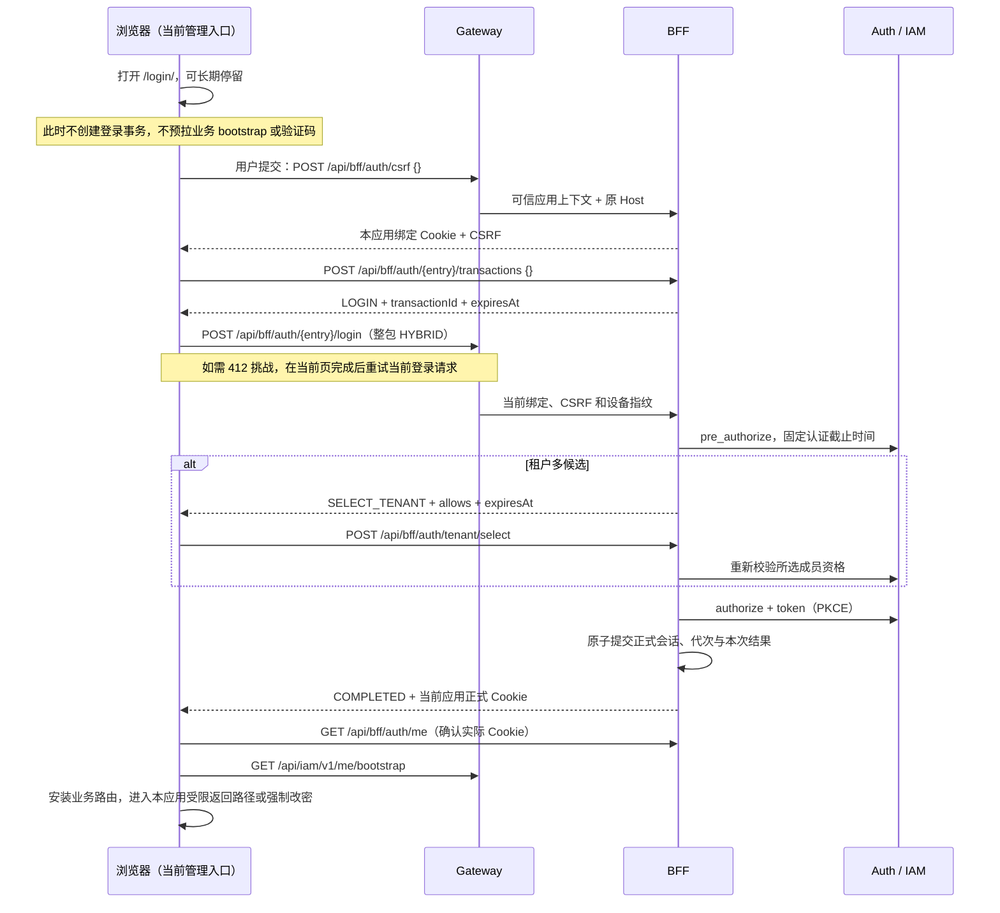

# 管理台同源 BFF 登录流程

平台和租户各有一个管理入口，登录页面位于各自的 `/login/`，由同一份 SPA 提供。前端只部署 `admin-platform` 和 `admin`；后端 `ingot-auth` 继续负责 OAuth2、PKCE、凭证校验与会话撤销，BFF 保存 Token，浏览器只持有 HttpOnly Cookie。正式会话提交前经 Auth 的 sid 查询确认身份；公开 Token 响应中没有内部用户字段，用户 ID 来自 Auth 会话主数据。

本文描述当前实现。接口细节见 [同源登录 API](../../../specs/changes/archive/2026/20261031-security-same-origin-login/API.md)，部署和切换见 [发布指南](../../../deploy/services/SAME-ORIGIN-LOGIN.md)。本地自动化已完成，真实 Auth/IAM、客户 CA、休眠及生产切换/回滚仍待联合验收，见 [验证记录](../../../specs/changes/archive/2026/20261031-security-same-origin-login/VALIDATION.md)。历史设计保留在 Spec 中。

## 入口与职责

| 应用 | 本机 DEV 登录地址 | 双域名生产示例 | 纯 IP HTTPS 示例 |
|---|---|---|---|
| 平台 `platform-admin` / `PLATFORM` | http://platform.localhost:5799/login/ | https://platform.example.com/login/ | https://192.168.1.100:8443/login/ |
| 租户 `tenant-admin` / `TENANT` | http://tenant.localhost:5798/login/ | https://admin.example.com/login/ | https://192.168.1.100:9443/login/ |

`*.localhost` 在浏览器回环到本机。每个入口的 `/api/` 代理到 Gateway，Host 必须保留实际端口。平台、租户分别使用独立的内部 OAuth 客户端 `in-bff-platform`、`in-bff-tenant`；实际配置以 Nacos 和 Auth RegisteredClient 为准。

Gateway 根据可信 Host/端口匹配 `ingot.bff.apps[].origin`，覆盖内部应用头；BFF 再核对应用、入口和来源。浏览器不提交 appId、domain、clientId、回调地址或跨域跳转地址。OAuth redirect URI 是与 RegisteredClient 精确匹配的内部协议值，浏览器不访问它。

| 层 | 职责 |
|---|---|
| `apps/admin-platform`、`apps/admin` | 组合登录插件与管理页面，提供公开静态 `/login/` 路由 |
| `plugins/auth` / `packages/auth-core` | 表单、事务状态、租户选择及有界恢复；复用管理宿主网络和唯一挑战组件 |
| Gateway | 可信入口识别、限流/412 挑战、本应用 Cookie 中继与会话检查 |
| BFF | CSRF/绑定、事务、Auth 协议交换、原子会话提交和撤销补偿 |
| Auth / IAM | 真实凭证、预授权期限、身份及成员资格校验、Token 与 sid 生命周期 |

## 正常登录

平台入口不选择租户。租户零候选拒绝，单候选校验后直接登录，多候选始终留在本页。登录成功由当前 origin 直接建立会话，正常流程没有浏览器票据兑换和跨站往返。

返回路径只在本应用保存并限制为合法相对路径；绝对 URL、`//`、反斜杠及认证页循环目标会被拒绝。密码、Token、CSRF 不写 URL、日志或持久化浏览器存储。

## 接口与长期停留

下表为服务端路径，浏览器添加当前 origin 的 `/api` 前缀。`{entry}` 只能是当前应用对应的 `platform` 或 `tenant`。

| 方法与路径 | 用途 |
|---|---|
| `POST /bff/auth/csrf` | 同源 JSON 自举，复用有效匿名绑定与 CSRF |
| `POST /bff/auth/{entry}/transactions` | 点击提交时创建事务；空 JSON，无跳转 URL |
| `POST /bff/auth/{entry}/login` | 整包 HYBRID 密码认证；返回选择或完成状态 |
| `POST /bff/auth/tenant/select` | 当前绑定下选择允许的租户，成功直接写正式 Cookie |
| `GET /bff/auth/{entry}/transactions/{id}` | 只读本次结果，识别处理中或完成状态 |
| `POST /bff/auth/{entry}/transactions/{id}/resume` | 已完成且未交付时，有界重新下发同一个会话 Cookie |
| `GET /bff/auth/me` | 校验本应用实际 Cookie、当前代次与 Auth sid |
| `DELETE /bff/auth/logout` | 只退出当前应用，清理本应用 Cookie 并阻止旧结果恢复 |

登录页本身没有事务有效期。默认在点击时才创建 600 秒事务，打开页面或恢复焦点不续期。未认证的准备凭证失效时原地重建一次；认证/租户选择已过期则在当前页面重新认证。选择期限取事务硬截止和 Auth 返回的 `authenticationExpiresAt` 的最早值，读取与挑战不延长该期限。

结果不确定时先查本次事务，禁止盲目重放密码或换码。`AUTHENTICATING` / `COMMITTING` 有界等待（前端最多 15 秒）；只有确认本次 `COMPLETED` 且 Cookie 未交付时才尝试一次 resume。默认恢复窗口 60 秒，退出、撤销或新身份替换后不能恢复旧结果。503 表示依赖不可用，保留当前页面状态；不能当成会话过期并循环跳转。

常见状态码：事务过期 `410 BFF_TRANSACTION_EXPIRED`，来源/绑定/CSRF 不符 `403`，处理中或结果不可恢复 `409`，容量超过 `429 BFF_LOGIN_CAPACITY`，认证依赖故障 `503 BFF_AUTH_UNAVAILABLE`。账号锁定、凭证错误和强制改密沿用原业务契约。

## Cookie、来源与状态约束

| 场景 | 平台正式 / 绑定 | 租户正式 / 绑定 |
|---|---|---|
| HTTPS | `__Host-IN_PLATFORM_SESSION` / `__Host-IN_PLATFORM_BINDING` | `__Host-IN_TENANT_SESSION` / `__Host-IN_TENANT_BINDING` |
| loopback HTTP DEV | `IN_PLATFORM_SESSION` / `IN_PLATFORM_BINDING` | `IN_TENANT_SESSION` / `IN_TENANT_BINDING` |

认证 Cookie 由后端设置：HttpOnly、Path=/、SameSite=Lax、无 Domain，HTTPS 加 Secure。前端 `VITE_APP_COOKIE_DOMAIN` 不控制这些认证 Cookie。生产必须 HTTPS，只有 loopback DEV 可以关闭 `require-https`。

纯 IP 双端口共享 Cookie 主机范围，两套 Cookie 可能都被发送。每个应用只消费、撤销和清理自己的名称，并校验 appId/domain、绑定、当前会话代次和有效 sid；另一应用的 Cookie 不提供当前入口身份。两个端口必须同属可信部署，端口不能提供 Cookie 发送隔离。浏览器存储与跨标签页通知按 origin 隔离。

除 CSRF 自举外的写接口须带绑定 Cookie 和 `X-CSRF-Token`，自举本身也严格校验同源 JSON 与 Origin；Cookie 中继业务写请求同样校验精确 Origin。不开放跨域凭证请求，不用 Referer 覆盖错误 Origin。设备指纹、账号失败保护、网关限流及 412 挑战继续生效。

Redis 使用 `in:bff:v2:{platform-admin}:` 与 `in:bff:v2:{tenant-admin}:`，每应用同槽原子推进事务和会话代次。清理任务无 TTL，撤销成功后移除；未知远端结果不能无条件重试换码。认证 Feign 日志必须关闭敏感 URL/头/Body 输出。

## 启动、配置与兼容边界

本机使用 Java 21 启动 dev profile 的 Auth（5100）、BFF（5400）、Gateway（7980）及 IAM/安全中心依赖。前端在 Node 22.17 / pnpm 10.12.4 下执行 `pnpm install --frozen-lockfile`、`pnpm build:packages`、`pnpm dev`，只启动两个管理入口。

同步相应 Nacos Group 的 `in-bff-apps.yml`、`in-service-bff.yml`、`in-service-gateway.yml`、`in-security-gateway.yml`、`in-service-auth.yml`；Auth 配置不再设置指向独立登录站的 `loginFormUrl`。Gateway/BFF 的注册配置必须一致；变更 Host、端口或 HTTPS 后两侧与边缘代理一起同步。初始化 SQL 的这五份配置与 YAML 一致，已有环境通过 Nacos 正常发布配置，不能重新导入初始化 SQL 覆盖业务库。

静态 SPA 深链和 `/login/` 刷新回本应用 index.html，`/api` 不回退 HTML；多层代理保留包含端口的 Host 以及受控边缘确认的外部 HTTPS scheme。证书 SAN 必须包含实际域名/IP，客户端信任 CA。

旧 `/auth/start`、`/auth/complete`、`/oauth2/challenge` 仅作为页面链接兼容：清空参数后进入本域 `/login/`。旧 complete API、READY/ticket 交接协议和独立登录站不再运行。退役登录域如保留静态引导，目标必须固定，不能由 query 控制。历史发布回滚说明和旧状态只读盘点仍保留，详见发布指南。

外部 OAuth2/OIDC 接入属于独立能力，不复用内部管理台的 `/login/` 作为通用授权页面。本轮不删除后端 Auth 服务或 OAuth2 协议接口。
