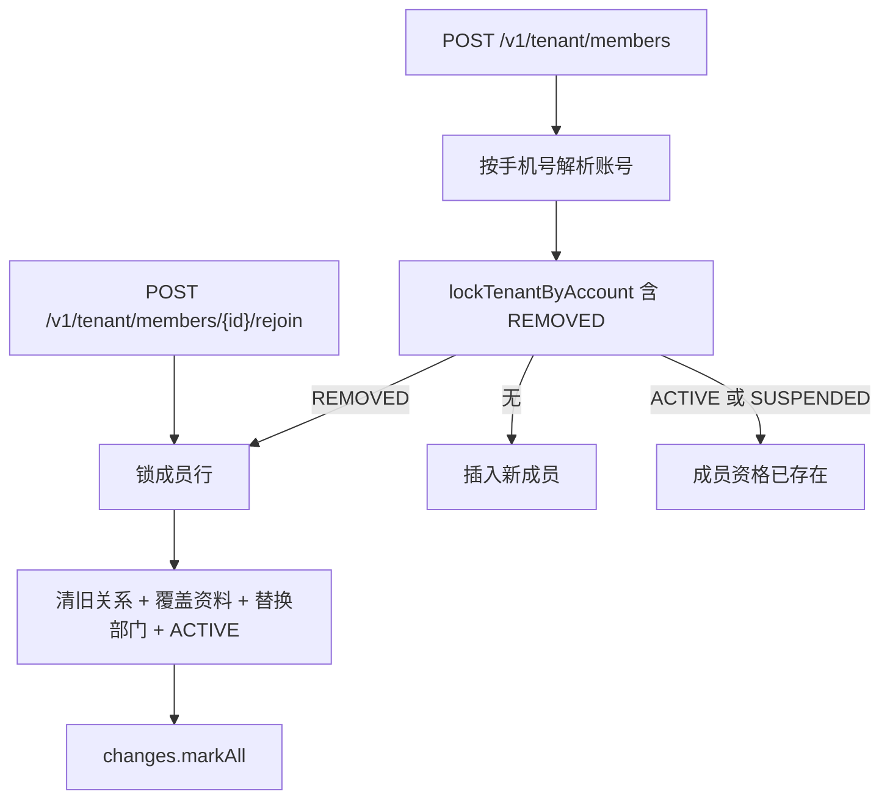

# Design

## 方案摘要

新增 `MemberRejoin`：在同一事务内锁定已移出成员行，清理授权关系，覆盖通讯录资料和任职，将资格改回 `ACTIVE`。`TenantMemberOnboarding` 按 `(tenant_id, account_id)` 持锁查询，命中 `REMOVED` 时转入重新加入；行入口 `POST /{id}/rejoin` 走同一核心。

## 数据模型与接口

- `TenantMemberRejoinInput`：`expectedVersion`、`displayName`、`phone`、可选 `email`、`departments`；未知字段拒绝。
- `TenantMemberCreated` 增加 `rejoined`。
- `POST /v1/tenant/members/{id}/rejoin` 权限 `TENANT_MEMBER_CREATE`，响应与创建相同信封。
- 不改表结构。唯一键 `(tenant_id, account_id)` 决定必须复用原行。
- 策略选择器表无 version，只删 `iam_policy_selector_member`。

## 数据流与失败处理

1. 校验未知字段、手机号形态和部门形状；行入口再校验乐观锁。
2. `CREATE` 鉴权、锁定组织、锁定成员（含 `REMOVED`）。
3. 账号停用拒绝；非 `REMOVED` 报已存在；无行报对象不存在。
4. 对象范围与字段写门禁沿用创建成员。
5. 按成员清理关系；撤销分配/委派各写 `DISABLE` 审计。
6. 替换部门、覆盖资料、`REMOVED`→`ACTIVE`、成员 version+1。
7. 成员写 `ENABLE` 审计（状态、姓名、部门与清理计数），失效授权缓存。

失败整笔回滚。

## 迁移与回滚

无需数据迁移。回滚去掉 rejoin 接口与入职分支即可，已重新加入的行保持 `ACTIVE`。

## 测试策略

- `TenantMemberOnboardingTest`：已移出自动重新加入；在职/暂停仍拒绝。
- `MemberRejoinTest`：关系清理、version、身份恢复、版本冲突、事务回滚。
- 契约测试纳入 `TenantMemberRejoinInput` 与 `rejoined`。
